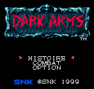
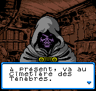
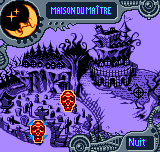

# Dark Arms - Beast Buster 1999 — traduction française

**Dark Arms - Beast Buster 1999** (*Beast Buster - Yami no Seitai Heiki*, Neo Geo Pocket Color, SNK, 1999),
entièrement en français : tous les dialogues (le Maître, Joyce, dame Raison, les villageois, Caso, la fin),
les fiches des 47 bêtes et des 33 armes, les noms, les menus d'Élevage, les options, la sauvegarde, le mode
Combat, ainsi que les inscriptions dessinées : bandeaux, barre d'état, noms des lieux de la carte, Jour/Nuit.

<p align="center">
  
  
  
</p>

- **Partie 1 (français)** : jouer en français — le patch et comment l'appliquer.
- **Part 2 (English)** : the translation kit — tools and guide to translate the game into another language.

---

# Partie 1 — Jouer en français

## 1.1 Ce qu'il vous faut

Le patch : `patch/Dark_Arms_FR_v1.0.ips`.

**Votre propre** copie de la cartouche, non modifiée et sans en-tête. Aucune ROM n'est fournie ici.
C'est une cartouche **bilingue** (japonais / anglais dans la même ROM) : il n'existe qu'une version. Vérifiez-la :

| | ROM d'origine attendue |
|---|---|
| Nom (par exemple) | `Dark Arms - Beast Buster.ngc` |
| Taille | 2 097 152 octets |
| CRC32 | `6F353F34` |
| MD5 | `fe0e58d34d650ae5174ca03d3efc67b0` |
| SHA-1 | `727d8100fa7c4a39a6be9133bd903b868b4cc834` |

Avec une ROM déjà modifiée ou un autre dump, le patch donnera un jeu cassé.

## 1.2 Réglez la console (ou l'émulateur) en **anglais**

Le jeu affiche la langue choisie dans les réglages de la console. Le français **remplace la version
anglaise** : réglez la langue de la console, ou de l'émulateur, sur **anglais** (English). En japonais, le jeu
reste en japonais (avec des katakana abîmés, leurs cases ayant servi aux lettres accentuées).

## 1.3 Méthode A — patch appliqué à la volée par l'émulateur

L'émulateur applique le patch en mémoire à chaque lancement : la ROM d'origine n'est **pas modifiée**.
Posez le fichier `.ips` à côté de la ROM, **sous le même nom**, puis lancez la ROM normalement :

```
Dark Arms - Beast Buster.ngc
Dark Arms - Beast Buster.ips
```

## 1.4 Méthode B — créer une ROM française (console, ou tout autre émulateur)

Fabriquez une fois pour toutes une ROM patchée :

- avec un outil IPS courant : **Rom Patcher JS** (dans le navigateur), **Flips** ou **Lunar IPS** ;
  choisissez la ROM, puis le `.ips`, et enregistrez le résultat ;
- ou avec l'outil fourni (Python 3) :

  ```
  python tools/ips.py apply "Dark Arms - Beast Buster.ngc" patch/Dark_Arms_FR_v1.0.ips Dark_Arms_FR.ngc
  ```

La ROM obtenue doit avoir ces empreintes, quel que soit l'outil :

| | ROM française obtenue |
|---|---|
| Taille | 2 097 152 octets |
| CRC32 | `EDF785E0` |
| SHA-1 | `4903271fc77c49fca0b61e35acf75882c534c48e` |

## 1.5 Sauvegarde

La taille de la ROM ne change pas et le patch ne touche pas à la zone de sauvegarde de la cartouche : la
sauvegarde fonctionne comme dans le jeu d'origine. (Reprendre avec la version française une partie commencée
en version d'origine n'a pas été testé.)

## 1.6 Ce qui a été vérifié, ce qui ne l'a pas été (v1.0)

Vérifié à l'émulateur : écran titre et menu, nouvelle partie, introduction du Maître, saisie du nom, Maison du
Maître et son menu, barre d'état, sauvegarde (question, confirmation, écriture au bon endroit), carte du monde
et noms des lieux, Jour/Nuit, entrée dans le Cimetière, écran des options (catalogues, effacement des données,
extinction automatique), bandeaux.

Tout le texte est contrôlé automatiquement (largeur et nombre de lignes de chaque boîte, place des menus,
caractères disponibles) et a été relu contre le japonais.

Pas encore vu à l'écran en situation : les dialogues des villageois au-delà de la sauvegarde, les menus
d'Élevage, les fiches des catalogues remplies, le mode Combat (il faut deux consoles reliées) et la fin. Un
retour est bienvenu si un texte déborde ou se coupe. La ROM n'a pas encore été essayée sur une vraie console.

## 1.7 Choix de traduction

- Traduit depuis le **japonais** : la version anglaise résume et contient des contresens (balles « de
  capture », fiches de bêtes…). On **adapte** plutôt qu'on ne traduit mot à mot : chaque réplique doit avoir du
  sens dite par ce personnage, dans son registre.
- Vocabulaire : Arme, Germe, Oum, proie, Capteur, Élevage, Force (feu / glace / foudre), dame Raison, Caso,
  Joyce, Maître Schatten, Ville Errante, Village Éveillé, Dark Raom… (liste complète :
  `lang/fr/GLOSSAIRE.md`).
- Lettres accentuées ajoutées à la police (é è ê ë à â ç ù û î ï ô œ É È Ê À Â Ç Î Ô). Images redessinées :
  bandeaux HISTOIRE et TERRAIN, barre d'état VIE / PUIS / PRISES, les six noms de lieux de la carte,
  Jour / Nuit. Laissés tels quels : le logo (titre officiel du jeu), « OPTION » (la place du menu titre est
  limitée à 6 lettres), « PAUSE » (identique en français) et le générique.

## 1.8 Crédits

- **Traduction française, lettres accentuées, images, outils** : **Tixul**, sous **licence MIT** (fichier
  `LICENSE`) pour les outils et les fichiers de traduction.
- *Dark Arms - Beast Buster 1999* © 1999 SNK. Ce projet de fans n'est ni affilié ni approuvé par les ayants
  droit. Il ne contient **ni ROM, ni BIOS, ni texte d'origine** : le patch ne contient que des octets
  modifiés, et le texte anglais ou japonais n'est obtenu qu'en l'extrayant de sa propre ROM.

---

# Part 2 — Translation kit (English)

Everything needed to translate the game into **another Latin-alphabet language**. You edit text files; the
tools rebuild the ROM (relocated strings, accented font, redrawn lettering) and refuse to build while a rule
is broken.

| Folder / file | Content |
|---|---|
| `lang/fr/` | the French translation (`*.tsv`), style guide `CONSIGNES.md`, glossary `GLOSSAIRE.md` — use it as your template |
| `tools/` | extract the text paired with the Japanese text, check a translation, build the ROM and the IPS patch |
| `patch/` | the released French patch |
| `screenshots/` | the screenshots shown at the top of this file |
| `FORMAT.md` | technical notes on the ROM: text, script, font, graphics, save (in French) |

## 2.1 Requirements
- Python 3.9 or later; **Pillow is not needed** (no other package).
- The ROM `Dark Arms - Beast Buster.ngc` (hashes in section 1.1). It contains both the Japanese and the
  English text: the build checks it and refuses any other file.

## 2.2 Steps
1. **Extract the text** from *your own* ROM (it is not distributed):
   ```
   python tools/sources.py "Dark Arms - Beast Buster.ngc"
   ```
   This writes `out/src/maitre.txt` and `out/src/pnj.txt` (each conversation: the Japanese pages, then the
   English pages to translate, one per address), `out/src/descs.txt` (descriptions, Japanese and English) and
   `out/catalogue.tsv` (every string: address, pointer sites, JP/EN, text — menus included).
2. **Copy** `lang/fr` to `lang/<code>` (e.g. `lang/es`) and translate the five `.tsv` files (rules below).
3. **Check, then build** the ROM and the patch, and test in an emulator set to **English**:
   ```
   python tools/controle.py --rom "Dark Arms - Beast Buster.ngc" --lang <code>
   python tools/build.py --rom "Dark Arms - Beast Buster.ngc" --lang <code> --ips
   ```
   Output: `out/<code>.ngc` and `out/<code>.ips` (checked by re-applying it).
   ⚠️ Distribute the **.ips** only, never the ROM.

## 2.3 File format and rules

One line per English string: `ADDRESS<TAB>text` (UTF-8, file address in hex, as in `out/src/` and
`out/catalogue.tsv`); `#` starts a comment line. `|` = new line, `{F900}` = hero name (count 6),
`{FA00}` = yes/no prompt code, `{FDxx}{FCxx}` = position codes, `{XXXX}` = raw 16-bit word. Do not write the
leading `{FA03}`/`{FA04}` of dialogue pages: the build copies it from the English page.

| File | Content | Limit |
|---|---|---|
| `maitre.tsv` | Master, Joyce, Raison, ending | 3 lines × 16 |
| `pnj.tsv` | villagers, Caso, save | 2 lines × 15 (yes/no prompts: 16) |
| `descs.tsv` | beast / weapon descriptions; weapon origins (0x0F3E60+) | 5 × 16; 3 × 14 |
| `noms.tsv` | weapon and beast names | English length (12 / 13) |
| `menus.tsv` | menus, options, VS mode | same lines as the English, each ≤ the English line |

- A conversation's text may be spread freely over its English pages, but every page must keep some text.
- Menus: keep the English columns (yes/no words, `[A]`/`[B]`); the title menu cursor allows 10 / 8 / 6
  characters on its three lines.
- Characters: ASCII and `é è ê ë à â ç ù û î ï ô œ É È Ê À Â Ç Î Ô`, drawn by hand on unused font codes
  (`tools/police.py`: change the list and the drawings for your language).

Language-specific data living in the tools (edit them for your language): `tools/graphismes.py` (banners,
HUD words, place names, Day/Night: `LIEUX`, `JN`, `mot_hud(...)` calls and the hand-drawn letters).

## 2.4 Credits and legal
- French translation, accented letters, graphics and tools: **Tixul**, released under the **MIT License**
  (see `LICENSE`).
- *Dark Arms - Beast Buster 1999* © 1999 SNK. This fan project is not affiliated with or endorsed by the
  rights holders. It contains **no ROM, no BIOS and no original game text**; the English and Japanese text is
  only obtained by extracting it from your own ROM.
